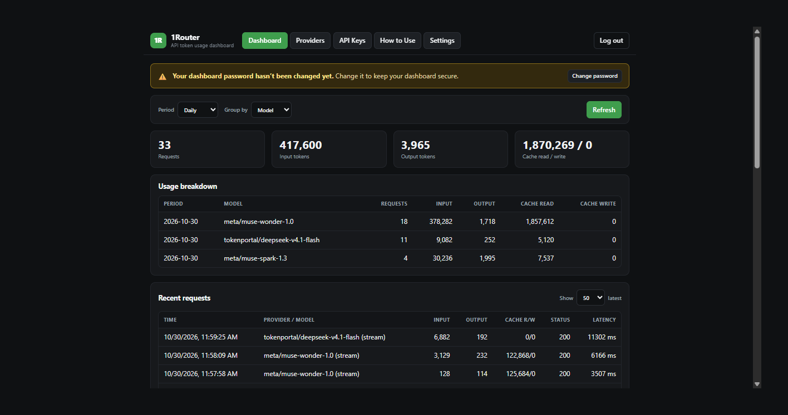

# 1Router

**One local endpoint for all your LLM providers — with every token counted.**

1Router is a small, self-hosted proxy that sits between your tools (Pi,
scripts, apps) and your LLM providers (OpenAI, Anthropic, DeepSeek,
Ollama, any compatible endpoint). Your tools talk to 1Router with a single
local API key; 1Router forwards each request to the right provider and
records exactly how many tokens it used — input, output, cache read, and
cache write — per client key, provider, and model.

No config files, no cloud account, no telemetry: everything (providers,
keys, usage history) lives in one local SQLite database and is managed
from a built-in web dashboard.



- 🧮 Daily / weekly / monthly / yearly / all-time token totals
- 🔑 Multiple named client API keys (one per device or app, revocable)
- 🔌 Three API types: `openai-completions`, `openai-responses`, `anthropic-messages`
- 📡 Streaming supported — tokens are counted without buffering the response
- 🪶 Zero runtime dependencies (Node `http` + `sqlite`), vanilla HTML/CSS/JS dashboard

> 1Router deliberately does **not** estimate cost, translate between
> protocols, or do fallback routing. It forwards same-protocol requests
> transparently and counts what providers report.

**Inspired by [Pi](https://pi.dev).** 1Router was built by a Pi user, for
Pi users first: it borrows Pi's minimalist philosophy (small, transparent,
no magic) and its three API types (`openai-completions`,
`openai-responses`, `anthropic-messages`) from Pi's `models.json` design —
then hides all of that behind a dashboard so you never have to edit the
file by hand. It also generates a ready-to-paste Pi `models.json` snippet
for your providers (see the How to Use tab in the dashboard).

## Use cases

- **"Which of my tools is burning tokens?"** — give Pi, your laptop, and
  your scripts separate 1Router keys and compare them in the dashboard.
- **"Is prompt caching actually working?"** — cache read/write tokens are
  tracked separately for every request.
- **One key to rule your tools** — point everything at
  `http://127.0.0.1:8787/v1` and swap providers or provider keys in the
  dashboard instead of editing every app's config.
- **Local + cloud together** — route `ollama/…` models to a local server
  and `anthropic/…` to the cloud through the same endpoint, with usage
  for both in one place.
- **Auditing a new tool** — create a key just for it, watch Recent
  Requests live, revoke the key when you're done.

## How to

### 1. Install and start

Requirements: Node.js ≥ 22.19.

```bash
npm install
npm start          # http://127.0.0.1:8787
```

Open **http://127.0.0.1:8787** and log in. The first-run dashboard
password is shown by the login page (and printed in the server log);
change it in **Settings** — the dashboard reminds you until you do.

### 2. Add a provider (Providers tab)

A *provider* is where requests actually go. For each one you enter:

| Field | Example | Notes |
|---|---|---|
| Name / Slug | `DeepSeek` / `deepseek` | The slug becomes the model prefix |
| API type | `openai-completions` | One of the three supported types |
| Base URL | `https://api.deepseek.com/v1` | The provider's API root |
| Provider API key | `sk-…` | Stored locally; shown masked (`••••last4`, short keys fully hidden) afterwards |
| Models | `deepseek-chat` | One per line, or press **Fetch models** to list them from the provider |

After models are added, each gets capability controls: **Images** is never
assumed — 1Router blocks image input unless you explicitly enable it for
that model. **Reasoning** is manual too: tick the levels to expose
(`minimal`–`max`) and pick a default. 1Router does not match providers or
model names to built-in profiles. Use **Try a thinking level** in How to
Use to test whether a provider accepts a level before enabling it.

### 3. Create a client key (API Keys tab)

Client keys (`sk-1r-…`) are what your apps use to talk to 1Router —
**never give apps your provider key**. Create one per device/app; the
full key is shown only once, so copy it immediately. Revoking a key
cuts off anything using it, without touching your providers.

### 4. Point your tool at 1Router (How to Use tab)

The dashboard generates everything for you: your base URL
(`http://127.0.0.1:8787/v1`), a ready-to-paste **curl** example, and a
**Pi `models.json`** snippet built from your actual providers. The rules
are always the same:

- **Base URL:** `http://127.0.0.1:8787/v1`
- **API key:** a 1Router key (`sk-1r-…`)
- **Model:** `<provider-slug>/<model>`, e.g. `deepseek/deepseek-chat`

Try it right there with **Send test request**, then check the Dashboard —
your test was just counted.

```bash
curl http://127.0.0.1:8787/v1/chat/completions \
  -H "Authorization: Bearer sk-1r-…" \
  -d '{"model":"deepseek/deepseek-chat","messages":[{"role":"user","content":"hi"}]}'
```

Endpoints by API type:

| API type | Endpoint | Client auth header |
|---|---|---|
| `openai-completions` | `POST /v1/chat/completions` | `Authorization: Bearer sk-1r-…` |
| `openai-responses` | `POST /v1/responses` | `Authorization: Bearer sk-1r-…` |
| `anthropic-messages` | `POST /v1/messages` | `x-api-key: sk-1r-…` (Bearer also works) |

`GET /v1/models` (with a client key) lists every model as `provider/model`.

### 5. Read the Dashboard

- **Period** (daily/weekly/monthly/yearly/all-time) × **group by**
  (provider / API key / model). Weekly rows show the Monday–Sunday range.
- **Recent Requests** (show 10–100) lists each call with its token split,
  HTTP status, latency, and the reasoning **effort** the client requested
  (`provider` when the client did not specify one). `(no usage)` means the
  provider didn't report token counts for that request — nothing to count.
- The summary cards always add up **every row shown** for the selected
  period grouping (choosing Daily groups all history by day; it is not a
  today-only filter).

### Troubleshooting

| Symptom | Fix |
|---|---|
| `401` | The app isn't using a 1Router key — use `sk-1r-…`, not a provider key |
| `400 Unknown model` | Model must be `<slug>/<model>` exactly as in the Providers tab |
| `400 … wrong endpoint` | Endpoint doesn't match the model's API type (see table above) |
| `502 Could not reach provider` | Provider Base URL wrong, or a local server (Ollama) isn't running |
| Dashboard asks for login again | Session expired (7 days) — log in again |

## How it works

- Login password is stored in SQLite as a scrypt hash; it only protects
  the dashboard. Client API keys are SHA-256 hashed and only authorize
  proxy requests — the two are separate.
- Provider credentials are stored in SQLite (the proxy must be able to
  send them), are masked in the UI, and are never returned by the API
  after saving. The dashboard session cookie is never forwarded upstream.
- Usage is normalized so tokens are never double-counted: OpenAI reports
  cached tokens inside its input total (1Router subtracts them);
  Anthropic reports input/cache separately (used as-is). Streaming
  responses are observed chunk-by-chunk, never buffered whole.
- Upstream responses are re-sent with transport headers fixed (e.g.
  `content-encoding` is stripped after decompression, which otherwise
  breaks browser clients with "Failed to fetch").

Env: `PORT` (8787), `HOST` (127.0.0.1), `DB_PATH` (`data/1router.db`).

### Backup & restore

**Settings → Backup & export → Download SQLite backup (.db)** saves a copy
of the whole database (providers incl. their keys, client keys, settings,
usage history; login sessions excluded). Store it somewhere private. To
restore: stop 1Router, replace the database file with the backup, start
1Router again.

## Development

```bash
npm test   # TDD suite: usage parsing, auth, SQLite providers/stats, UI contracts, full proxy integration
npm start
```

Layout: `src/usage.ts` (per-API usage normalization + streaming parsers),
`src/reasoning.ts` (reasoning level validation + manual per-model
capability resolution; no provider/model matching),
`src/auth.ts` (password/session helpers), `src/db.ts` (SQLite: settings,
sessions, providers, keys, usage, stats), `src/server.ts` (proxy + admin API),
`src/cli.ts` (optional key management from the terminal),
`public/` (vanilla HTML/CSS/JS dashboard). See `docs/PLAN.md` for scope and
`AGENTS.md` if you're an AI assistant working on this repo.

## Credits

- [Pi](https://pi.dev) ([earendil-works/pi](https://github.com/earendil-works/pi))
  — the minimalist agent harness that inspired this project, its API-type
  taxonomy, and its `models.json` model. Pi is MIT-licensed; 1Router is an
  independent project and is not affiliated with or endorsed by Pi.

## License

[MIT](LICENSE) — © Panada.
