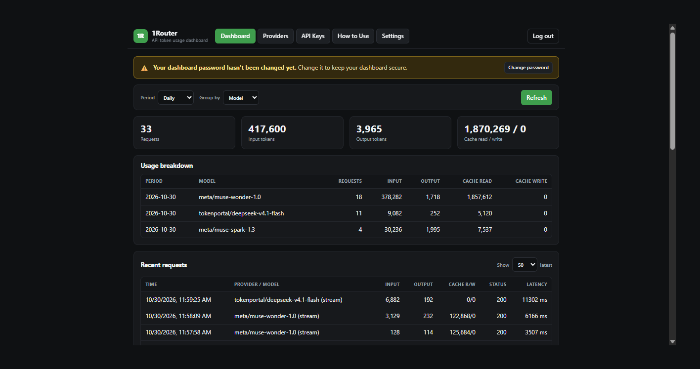

# 1Router

**One local endpoint for all your LLM providers — with every token counted.**

1Router is a small, self-hosted proxy that sits between your tools (Pi,
scripts, apps) and your LLM providers (OpenAI, Anthropic, DeepSeek,
Ollama, any compatible endpoint). Your tools talk to 1Router with a single
local API key; 1Router forwards each request to the right provider and
records exactly how many tokens it used — input, output, cache read, and
cache write — per client key, provider, and model.

No config files, no cloud account, no telemetry: everything (providers,
keys, usage history) lives in one local SQLite database and is managed
from a built-in web dashboard.



- 🧮 **Accurate token tracking** — Today / weekly / monthly / yearly / all-time totals, with cache read/write separation and no double counting
- 🌐 **Configurable timezone** — default GMT+8 (`Asia/Kuala_Lumpur`) or auto-detected from browser, ensuring daily boundaries align with your schedule
- 🔑 **Multiple named client API keys** — one per device or app (`sk-1r-…`), revocable without touching upstream provider keys
- 🔌 **Three API types** — `openai-completions`, `openai-responses`, and `anthropic-messages`
- 📡 **Transparent streaming** — tokens counted on the fly without buffering; client disconnects safely abort upstream requests
- 🧪 **Live test harness & capability probing** — test image inputs and reasoning effort levels directly from the dashboard
- 🪶 **Zero runtime dependencies** — built purely on Node.js built-ins (`http`, `sqlite`, `crypto`) with a precision telemetry dark HTML/CSS/JS dashboard

> 1Router deliberately does **not** estimate cost, translate between
> protocols, or do fallback routing. It forwards same-protocol requests
> transparently and counts what providers report.

**Inspired by [Pi](https://pi.dev).** 1Router was built by a Pi user, for
Pi users first: it borrows Pi's minimalist philosophy (small, transparent,
no magic) and its three API types (`openai-completions`,
`openai-responses`, `anthropic-messages`) from Pi's `models.json` design —
then hides all of that behind a dashboard so you never have to edit the
file by hand. It also generates a ready-to-paste Pi `models.json` snippet
for your providers (see the How to Use tab in the dashboard).

## Use cases

- **"Which of my tools is burning tokens?"** — give Pi, your laptop, and
  your scripts separate 1Router keys and compare them in the dashboard.
- **"Is prompt caching actually working?"** — cache read/write tokens are
  tracked separately for every request.
- **One key to rule your tools** — point everything at
  `http://127.0.0.1:8787/v1` and swap providers or provider keys in the
  dashboard instead of editing every app's config.
- **Local + cloud together** — route `ollama/…` models to a local server
  and `anthropic/…` to the cloud through the same endpoint, with usage
  for both in one place.
- **Auditing a new tool** — create a key just for it, watch Recent
  Requests live, revoke the key when you're done.

## How to

### 1. Install and start

Requirements: Node.js ≥ 22.19.

```bash
npm install
npm start          # http://127.0.0.1:8787
```

Open **http://127.0.0.1:8787** and log in. The first-run dashboard
password is shown on the login page (and printed in the server log);
change it in **Settings** — the dashboard reminds you until you do.

You can also create and inspect client keys from your terminal:

```bash
npm run key:create -- <name>   # create a named client key
npm run key:list               # list client keys and status
```

### 2. Add a provider (Providers tab)

A *provider* is where requests actually go. For each one you enter:

| Field | Example | Notes |
|---|---|---|
| Name / Slug | `DeepSeek` / `deepseek` | The slug becomes the model prefix |
| API type | `openai-completions` | One of the three supported types |
| Base URL | `https://api.deepseek.com/v1` | The provider's API root |
| Provider API key | `sk-…` | Stored locally; shown masked (`••••last4`, short keys fully hidden) afterwards |
| Models | `deepseek-chat` | One per line, or press **Fetch models** to list them from the provider |

The intended flow is: add a provider, test image and thinking levels in
**How to Use → Try it now**, then record only what the test proved under
**Model capabilities**. That metadata lives outside the provider list and
only describes models for generated config (for example Pi’s `models.json`);
it does not set model/provider behavior, gate requests, or override a
harness’s own config.

### 3. Create a client key (API Keys tab)

Client keys (`sk-1r-…`) are what your apps use to talk to 1Router —
**never give apps your provider key**. Create one per device/app; the
full key is shown only once, so copy it immediately (or click **Use in Try it now**
to populate it directly into the tester). Revoking a key cuts off anything
using it, without touching your providers.

### 4. Point your tool at 1Router (How to Use tab)

The dashboard generates everything for you: your base URL
(`http://127.0.0.1:8787/v1`), a live reactive **curl** command, and a
**Pi `models.json`** snippet built from your actual providers:

- **Base URL:** `http://127.0.0.1:8787/v1`
- **API key:** a 1Router key (`sk-1r-…`)
- **Model:** `<provider-slug>/<model>`, e.g. `deepseek/deepseek-chat`

#### Try it now & Capability Probing
- **Test server-side**: Select a model and client key, choose whether to probe with a minimal inline test image, or try a specific thinking level (`minimal`, `low`, `medium`, `high`, `xhigh`, `max`), then click **Send test request**. The request is executed securely server-side and recorded in your usage statistics.
- **Reactive curl**: The curl code snippet dynamically updates to reflect your model selection, image probe, and thinking parameters.
- **Search capabilities**: In **Model capabilities**, use the model filter search box to quickly locate models across providers and document proven image/thinking flags for exported configuration.

```bash
curl http://127.0.0.1:8787/v1/chat/completions \
  -H "Authorization: Bearer sk-1r-…" \
  -d '{"model":"deepseek/deepseek-chat","messages":[{"role":"user","content":"hi"}]}'
```

Endpoints by API type:

| API type | Endpoint | Client auth header |
|---|---|---|
| `openai-completions` | `POST /v1/chat/completions` | `Authorization: Bearer sk-1r-…` |
| `openai-responses` | `POST /v1/responses` | `Authorization: Bearer sk-1r-…` |
| `anthropic-messages` | `POST /v1/messages` | `x-api-key: sk-1r-…` (Bearer also works) |

`GET /v1/models` (with a client key) lists every configured model as `provider/model`.

### 5. Read the Dashboard

- **Period** (**Today** / weekly / monthly / yearly / all-time) × **group by**
  (provider / API key / model). Today reflects the current calendar day
  in your configured timezone. Weekly rows display the Monday–Sunday range.
- **Metric cards**: Show formatted compact totals (e.g. `12.5k`, `1.2M`)
  with full exact counts on hover. Totals always add up every row shown
  for the selected period.
- **Recent Requests** (show 10–100): Lists recent calls with monospace
  telemetry timestamps, provider/model, token breakdown (input, output,
  cache read/write), requested reasoning **effort** (`provider` when unspecified),
  colored HTTP status badges (`200 OK`, `4xx`, `5xx`), and latency. `(no usage)`
  means the provider did not report token counts.

### Troubleshooting

| Symptom | Fix |
|---|---|
| `401` | The app isn't using a 1Router key — use `sk-1r-…`, not a provider key |
| `400 Unknown model` | Model must be `<slug>/<model>` exactly as in the Providers tab |
| `400 … wrong endpoint` | Endpoint doesn't match the model's API type (see table above) |
| `429 Too many failed login attempts` | Rate limit triggered after repeated bad passwords; wait a few minutes and try again |
| `502 Could not reach provider` | Provider Base URL wrong, or a local server (Ollama) isn't running |
| Dashboard asks for login again | Session expired (7 days) — log in again |

## How it works

- **Auth separation**: Dashboard password is stored in SQLite as a scrypt hash; it only protects the web UI. Client API keys are SHA-256 hashed and only authorize proxy requests — the two credential systems never overlap.
- **Secure credentials**: Provider credentials are stored in SQLite (so the proxy can inject them), masked in the UI, and never exposed via any API after saving. The dashboard session cookie is never forwarded upstream.
- **Precise token counting**: Usage is normalized so tokens are never double-counted. OpenAI's `cached_tokens` is subtracted from its reported input tokens; Anthropic reports input and cache separately and is used directly. Streaming chunks are inspected incrementally without buffering full responses.
- **Transport hygiene**: Upstream responses are forwarded with clean transport headers (`content-encoding` and `set-cookie` are stripped after decompression to prevent browser fetch failures). Aborted client requests immediately terminate upstream fetches.
- **Configurable timezone**: Stored in SQLite settings (default `Asia/Kuala_Lumpur` / GMT+8). Drives the Today calendar boundary, aggregation bucketing, and dashboard timestamp displays.

Env: `PORT` (8787), `HOST` (127.0.0.1), `DB_PATH` (`data/1router.db`).

### Settings & backup

- **Timezone**: Set in **Settings → Timezone** from common regions or click **Use browser timezone**.
- **Password**: Change your dashboard login password anytime under **Settings → Change dashboard password** (minimum 6 characters).
- **Backup & restore**: **Settings → Backup & export → Download SQLite backup (.db)** downloads a clean SQLite snapshot (providers, masked credentials, client keys, settings, and usage history; active sessions are excluded). To restore: stop 1Router, replace the database file (default: `data/1router.db`), and start 1Router again.

## Development

```bash
npm test   # TDD suite: usage parsing, auth, SQLite providers/stats, UI contracts, full proxy integration
npm start
```

Layout: `src/usage.ts` (per-API usage normalization + streaming parsers),
`src/reasoning.ts` (reasoning level validation + manual per-model capability resolution),
`src/auth.ts` (scrypt password hashing, session tokens, default seeding),
`src/db.ts` (SQLite storage: settings, timezone, sessions, providers, keys, usage, stats),
`src/server.ts` (proxy, rate limiting, security headers, admin API, static files),
`src/cli.ts` (optional CLI key management),
`public/` (vanilla HTML/CSS/JS dashboard, dark telemetry theme). See `AGENTS.md` if you're an AI assistant working on this repo.

## Credits

- [Pi](https://pi.dev) ([earendil-works/pi](https://github.com/earendil-works/pi))
  — the minimalist agent harness that inspired this project, its API-type
  taxonomy, and its `models.json` model. Pi is MIT-licensed; 1Router is an
  independent project and is not affiliated with or endorsed by Pi.

## License

[MIT](LICENSE) — © Panada.
